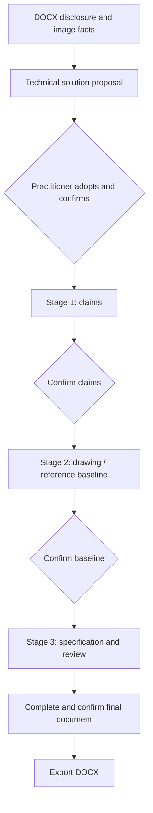

# 028 / TTC

**An AI-assisted patent drafting workflow for patent practitioners.**

TTC takes a DOCX technical disclosure through solution review, claims, drawing guidance and specification drafting. The practitioner chooses the technical solution and confirms the inputs used by later stages.

I designed and built the product with AI coding tools. My work covers requirements, the review process, implementation decisions, testing and iteration. This repository documents the product; its source code and professional rules remain private.

*Real application UI with synthetic fixture data and a mock model channel. [More screenshots](docs/DEMO_WALKTHROUGH.md).*

## Why I built it this way

Generating a full draft is only part of the task. A practitioner also needs to know which inputs a passage came from, what still needs review, and whether an edit has made later work obsolete.

TTC keeps these decisions explicit. For example, changing confirmed claims makes the old drawing/specification work stale. If a new generation fails, the previous usable version stays available.

## Workflow

The generation stages can inspect evidence, revise a draft and request an independent model review within a fixed budget. They cannot confirm work on the practitioner's behalf.

## What is working

- DOCX text/image extraction and private source storage.
- A solution table with individual adopt/reject decisions.
- Claims, drawing/reference and specification generation.
- Version history, confirmed snapshots and downstream invalidation.
- Failed-run drafts, call records and model usage.
- Account/case isolation, administration and document/dossier export.

Electrical cases have editable Draw.io artifacts. Mechanical cases currently have figure lists and reference-numeral guidance; finished mechanical drawings are outside the current scope.

## Engineering notes

| Problem | How TTC handles it |
| --- | --- |
| A review passed, then the draft changed | Reviews bind to a revision and content hash |
| Inputs changed during a long model call | Recheck confirmed inputs before publishing |
| A new run failed | Keep its draft separately; preserve the usable current version |
| Only a diagram's layout changed | Separate semantic identity from render/file identity |
| A model stream ended halfway through | Check completion, save failure details and let the user choose a retry |

[The decisions and trade-offs](docs/ENGINEERING_DECISIONS.md) · [Architecture](docs/TECHNICAL_ARCHITECTURE.md)

## Stack

Next.js 16, React 19 and TypeScript; SQLite with better-sqlite3; Mammoth and ZIP/XML parsing for DOCX; native fetch for Chat Completions and Responses APIs.

The stage execution runtime is part of the application.

## Demo and current status

TTC is in invitation-based testing. There is no public demo account. See the [walkthrough](docs/DEMO_WALKTHROUGH.md) for the demonstration scope.

Seven selected regression suites passed on 2026-10-14. They use synthetic data and mock models to test execution and state handling. Drafting quality still needs practitioner review; I have not published a quality benchmark or time-saving figure.

For a project you can use immediately, try my [Patent Exam Practice app](https://orphanwarrior.github.io/test-web/study.html).

## Further reading

- [Product case study](docs/PRODUCT_CASE_STUDY.md)
- [Feature status and limitations](docs/FEATURE_STATUS.md)
- [Validation details](docs/VALIDATION.md)
- [Synthetic disclosure example](examples/synthetic-case/DISCLOSURE.md)
