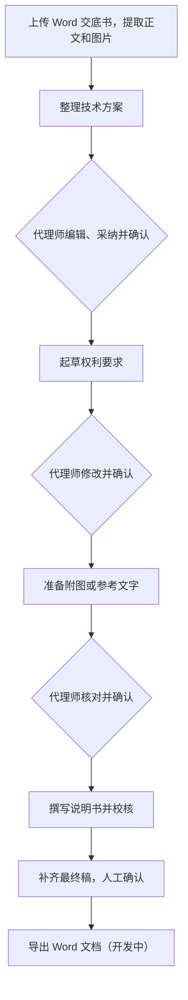

# TTC，一个 AI 专利撰写工作台

TTC全名Time to Claim-ready。是让代理师更快拿到一份可以继续完成交付的稿子，少花些时间大修大改。现在已经可以通过公网访问，正在邀请制内测。

本身技术出身，对这类工具的要求可能比较苛刻。通常的AI撰写平台一份专利生成出来，看着很长、很完整，拿到手却还是要改很多，那用起来就很难满意。TTC里我更在意的是后面这些修改怎么减少、代理师怎么介入。

所以流程分成方案、权利要求、附图和说明书几步。每一步先看结果，方向有问题就改，确认以后再往下走。

需求、产品流程、工程方案和开发迭代由我主导，实现中大量使用了 AI 编程工具。一位行业经验更丰富的伙伴参与专业撰写规则的测试和优化。核心代码和专业规则暂时没有开源，这里放项目介绍、界面和开发记录。

*截图来自实际应用，使用单独的测试环境、预置材料和模拟模型，没有客户案件。[继续看界面](docs/DEMO_WALKTHROUGH.md)。*

## 这两个月主要在改什么

权利要求质量控制花的时间最多。早期是固定工作流的生成、检查，再把问题反馈回去改。后来发现，问题有时需要回查交底，有时要重新组织整组权利要求，甚至得回头看方案提炼。这才开始引入Agent。

但自主步骤多了，过程也可能拖得很长。让模型逐句解释为什么这样写，它又可能替原稿找理由，稿子本身没改好。后来撤掉了一部分审核结构，把确定的步骤交给程序，只在需要判断的地方保留回查和修订。

方案表也结合实际的一般工作流程做了修改，代理师确认一条技术事实，模型却容易把它当成写作安排，直接搬进权利要求。我后来把确认的事实和表格分类分开处理，连上游提炼的内容也一起调整。

这些都有实际试验，也还有没解决好的地方。具体经过放在[做 TTC 的这两个月](docs/PRODUCT_CASE_STUDY.md)里。

## 现在的使用流程

Agent 可以在各自的任务里查材料、修稿和校核，有调用次数和时间限制。采纳什么、确认哪一版，还是由代理师来决定。

前面改了，后面已经生成的内容也需要重新核对。新一轮生成失败时，之前人工改过的稿子要保住。这些衔接在产品里都有处理，[这里记录了几个具体问题](docs/ENGINEERING_DECISIONS.md)。

## 已经能用的部分

- 上传 DOCX，提取正文和图片。
- 编辑、采纳或拒绝技术方案，再确认用于起草的内容。
- 分阶段生成权利要求、附图内容和说明书，查看和修改各版稿子。
- 上游修改后标记受影响的结果，生成失败时保留原稿和失败草稿。
- 按账号保存案件，通过后台管理规则、模型渠道和任务记录。

电学方向支持可编辑的 Draw.io 图。机械方向目前主要是附图列表和标记建议，完整机械图还没做出来。Word 导出也还在开发、补验中。

更细的进度放在[功能表](docs/FEATURE_STATUS.md)。

## 实现和验证

项目用 Next.js 16、React 19、TypeScript 和 SQLite。Word 处理用到 Mammoth、JSZip 和 XML 解析，模型通过原生 fetch 接入 Chat Completions 和 Responses。阶段执行、Agent 循环和版本检查由项目自己的代码处理。[这里有中文架构图](docs/TECHNICAL_ARCHITECTURE.md)。

整理这个仓库时跑过七项回归，使用合成材料和模拟模型，检查流程、版本绑定、权限和失败处理。此前也做过本地真实模型试验，专业判断仍有不足。现在还没有可靠的数据说明整件案件能省多少时间。[测试范围和还没验证的部分](docs/VALIDATION.md)都列在这里。

TTC暂时没有公共体验账号。想直接试一个项目，可以打开我的[专利代理师考试学习系统](https://orphanwarrior.github.io/test-web/study.html)，之前备考时做过，也给同事内部用过。

另外准备了一份[演示用交底书](examples/synthetic-case/DISCLOSURE.md)，方便后面做公开演示。
