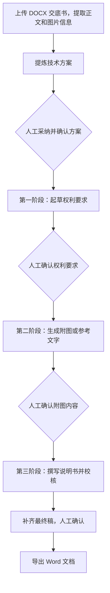

# 028 / TTC：我在做的 AI 专利撰写工作台

TTC 是我结合专利代理工作做的一个 AI 产品。上传 Word 交底书后，可以依次整理技术方案、起草权利要求、准备附图内容，再撰写说明书。每一步都留出审核和修改的位置，由代理师决定什么时候确认、继续。

我负责需求、流程设计、工程方案和测试迭代，开发过程中使用了 Codex 等 AI 编程工具。这里分享我为什么这样做、做到了哪一步，以及其中几个值得展开讲的工程问题。

*这是实际运行的界面。截图来自独立合成环境，使用预置测试材料和模拟模型，不涉及真实案件。[继续看界面](docs/DEMO_WALKTHROUGH.md)。*

## 我为什么想做 TTC

专利撰写里，有些问题在生成出一大段文字之后才刚刚开始：方案是不是理解对了？哪些内容有交底依据？权利要求改了，后面的说明书还对不对得上？

我希望 TTC 能把这些问题放到流程里处理。先看方案，再确认权要，接着核对附图和说明书。这样我能清楚地知道自己确认了什么，哪些内容还需要处理。

另一个我很在意的地方是保住已有的工作。新一轮生成失败，不应该把之前改好的版本一起带走。

## 使用流程

各阶段的 Agent 可以回查材料、修改草稿和调用独立校核，但有调用预算，也不能替代理师点击确认。

## 目前可以做什么

- 上传 DOCX 交底书，提取正文和图片，材料保存在私有存储中。
- 查看技术方案表，逐项编辑、采纳或拒绝，再确认要采用的版本。
- 生成权利要求、附图内容和说明书，并保留生成过程和版本。
- 前面的内容变化后，标记受影响的后续结果，避免继续使用旧稿。
- 保存失败任务的草稿、调用记录和模型用量，保留原有可用版本。
- 按账号隔离案件，提供后台管理、最终稿 Word 导出和完整案卷导出。

电学方向支持可编辑的 Draw.io 图。机械方向目前做到附图列表和标记对照建议，完整机械图还没有完成。

## 几个我花心思处理的问题

| 遇到的问题 | 我的处理方式 |
| --- | --- |
| 旧稿通过了校核，新稿却沿用了旧结论 | 让校核报告绑定具体修订号和内容指纹 |
| 模型生成期间，上游内容发生了变化 | 结果发布前，再检查一次确认版本和输入 |
| 重新生成失败，影响之前已经能用的稿子 | 把失败草稿单独保存，通过检查后才切换当前版本 |
| 只调整了图的排版，却要重写后续内容 | 分开记录图的语义和排版变化 |
| 模型流式输出中断 | 检查完成信号，记录失败，由用户决定是否重试 |

[展开看这些取舍](docs/ENGINEERING_DECISIONS.md) · [查看系统架构图](docs/TECHNICAL_ARCHITECTURE.md)

## 用到的技术

Next.js 16、React 19、TypeScript；SQLite 与 better-sqlite3；Mammoth、JSZip 和 XML 解析；通过原生 fetch 对接 Chat Completions 和 Responses 接口。

阶段执行和 Agent 循环由项目自身的代码实现。

## 想看实际效果

可以先看[截图与使用说明](docs/DEMO_WALKTHROUGH.md)。TTC 目前采用邀请制内测，还没有开放公共体验账号。产品源码、专业提示词和业务规则保留在私有仓库中。

我已经用合成数据和模拟模型跑过七项回归测试，覆盖流程、版本和失败处理。专利内容本身仍需要代理师审核，质量和节省时间的效果还需要继续验证。

如果想马上试用一个我做的项目，可以打开[专利代理师考试学习系统](https://orphanwarrior.github.io/test-web/study.html)。

## 继续了解

- [我为什么这样设计产品](docs/PRODUCT_CASE_STUDY.md)
- [功能进度与当前不足](docs/FEATURE_STATUS.md)
- [我做了哪些验证](docs/VALIDATION.md)
- [合成交底书示例](examples/synthetic-case/DISCLOSURE.md)
