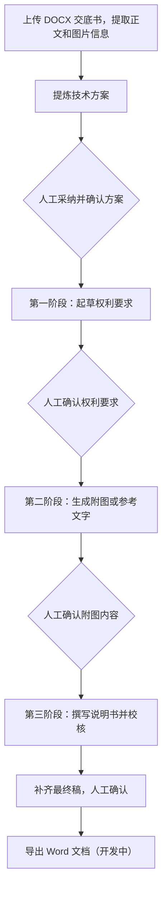

# TTC，一个AI专利撰写工作台

TTC全名time to claim-ready。是结合实际撰写经验做的一个AI产品，目前已经可以公网运行，邀请制内测中。

暴论现有的市面上的AI撰写平台或者网站都不好用，不管售价几何。他们都过于强调了一个专利申请的文本完成情况，对于外行来说或许确实可以轻易完成一个任务。但任何一个一年经验以上的人，对于任意前述平台的生成结果，很难达到满意或者愿意二次使用。因此，TTC不会是一个上传交底书就直接生成整篇专利的工具。目的是让有经验的用户可以在最短的时间内完成交付，即不用再大修大改，只需要补充个人书写习惯。

为此，结合软件工程思想和实际撰写流程，我把撰写过程拆成了几个阶段：先整理技术方案，再起草权利要求、准备附图内容，最后撰写说明书。每个阶段都可以由代理师检查、修改，确认后再进入下一步。

项目的需求、产品流程、工程方案和测试迭代由我主导，开发过程中大量使用了主流的AI编程工具。由我更有行业经验的伙伴进行skill测试和优化。

这个仓库主要介绍TTC目前做到了什么、为什么这样设计，以及开发过程中遇到的一些问题。产品的核心代码暂时没有开源。

*截图来自实际运行的界面，使用独立测试环境、预置材料和模拟模型，不包含真实客户案件。[查看更多界面](docs/DEMO_WALKTHROUGH.md)。*

## 为什么做TTC

实际让AI参与撰写工作辅助时，我发现单纯让AI生成一份专利初稿，解决不了后面的大部分问题。

比如，模型有没有真正理解交底书？权利要求中的技术特征有没有依据？修改了权利要求，之前写好的实施例还适不适用？

这些问题不一定能从一篇看起来通顺的生成结果中发现，但在实际撰写工作中都需要处理。

所以我没有选择直接做一个【上传文件后生成全文】的工具，而是把技术方案确认、权利要求撰写、附图处理和说明书撰写分开，让代理师能在每一步介入。

以及一些程序上的考虑：代理师已经花时间改好的内容，不能因为下一次模型调用失败就丢了。草稿、历史版本和生成记录都应该保留下来。

我希望 TTC 最终能减少代理师从接收交底书到完成可交付稿件所花的时间，而不是单纯追求生成速度。

## TTC的工作流程

各阶段的Agent可以回查交底材料、修改草稿、运行检查和调用独立校核，但不能无限调用模型，也不能代替代理师确认内容。

确认后的版本会成为下游任务的输入。如果上游内容发生变化，系统会检查已经生成的后续内容是否还有效。

## 目前做到了什么

现在TTC已经有一套可以运行的案件工作流，主要包括：

- **交底书处理：**上传DOCX，提取正文和图片信息，原始材料保存在私有存储中。
- **技术方案确认：**AI整理技术方案表，代理师可以逐项编辑、采纳或拒绝，再确认最终采用的方案。
- **分阶段生成：**生成权利要求、附图内容和说明书，各阶段保留草稿、生成记录和历史版本。
- **版本管理：**上游内容修改后，检查并标记受影响的下游结果，避免继续使用过期内容。
- **失败恢复：**生成失败或校核中断时保留已有草稿，不会直接覆盖之前的可用版本。
- **账号与后台：**按账号隔离案件，支持后台管理、最终稿Word导出（开发中）和完整案卷导出。

附图部分还没有全部完成。电学方向已经支持生成可编辑的Draw.io图；机械方向目前主要是附图列表和标记对照建议，还不能自动完成整套机械附图。

## 开发中遇到的几个问题

TTC开发过程中，有几个问题我花了比较多精力处理。它们看起来不直接影响模型写得好不好，但会影响代理师能不能放心地继续使用生成结果。

| 问题 | 目前的处理 |
| --- | --- |
| 草稿修改过，之前的校核报告还能用吗？ | 校核报告绑定草稿修订号和 SHA-256 内容指纹，不允许新稿直接沿用旧报告。 |
| 模型还在生成，用户却修改了上游内容 | 开始时记录输入版本，生成结束、准备发布时再核对一次。 |
| 点击重新生成，新任务失败了怎么办？ | 新任务独立保存，通过检查后才切换当前版本，原来的工作稿不受影响。 |
| 附图只调整了排版，说明书也要重新生成吗？ | 区分附图内容关系变化和纯排版变化，避免不必要的下游失效。 |
| 模型输出中断或者一直修不好 | 检查输出完成状态，限制 Agent 调用预算，失败后保存现场，由用户决定是否重试。 |

这些问题在项目里都有相应实现。我另外整理了一篇文章，写了具体的处理方式、为什么这样做，以及目前验证到什么程度。

[查看工程取舍](docs/ENGINEERING_DECISIONS.md) · [查看系统架构](docs/TECHNICAL_ARCHITECTURE.md)

## 技术实现

TTC使用Next.js16、React19和TypeScript开发，数据库采用SQLite。

DOCX内容提取和处理主要用到Mammoth、JSZip和XML解析。模型接入通过原生fetch实现，支持Chat Completions和Responses接口。

阶段任务调度、Agent执行循环、工具调用限制以及版本发布检查，都由项目自己的代码处理。

开发过程中，我主要负责把专利撰写中的业务要求转化成具体的工作流程、程序约束和验收条件，再借助一些agent完成实现、检查和修改。

## 演示与测试

TTC目前还没有开放公共体验账号。如果想了解实际界面，可以先看：

[截图及操作流程](docs/DEMO_WALKTHROUGH.md)

我已经使用合成交底材料和模拟模型完成了七项回归测试，主要检查各阶段能否正常衔接、版本是否正确绑定，以及模型失败时能否保留已有结果。

这些测试只能说明目前的程序流程符合预期，不代表生成的专利文本已经达到专业交付要求。实际撰写质量、代理师修改成本，以及能节省多少工作时间，还需要通过真实案件继续验证。

目前采用邀请制测试，产品源码、专业提示词和业务规则都保留在私有仓库中。

另外，我还有一个可以直接打开使用的小项目，之前在同事内部学习使用：[专利代理师考试学习系统](https://orphanwarrior.github.io/test-web/study.html)。这是独立于TTC的项目。

## 更多项目资料

- [产品设计思路](docs/PRODUCT_CASE_STUDY.md)
- [当前功能和未完成部分](docs/FEATURE_STATUS.md)
- [测试与验证记录](docs/VALIDATION.md)
- [合成交底书示例](examples/synthetic-case/DISCLOSURE.md)
