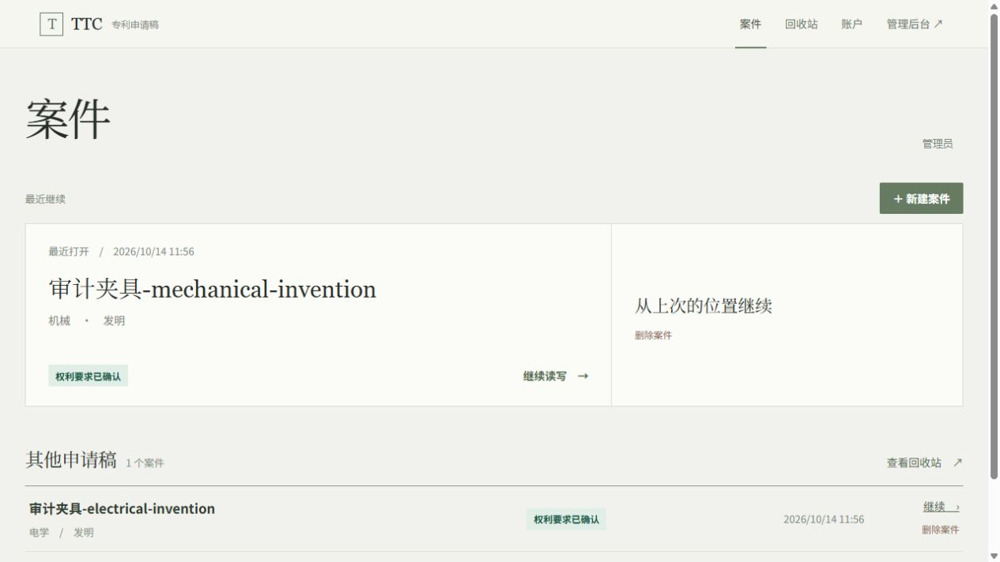
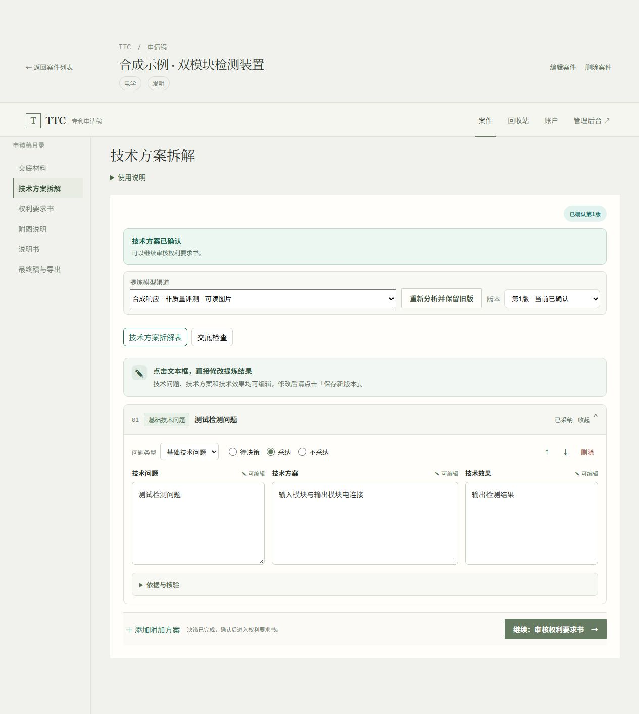
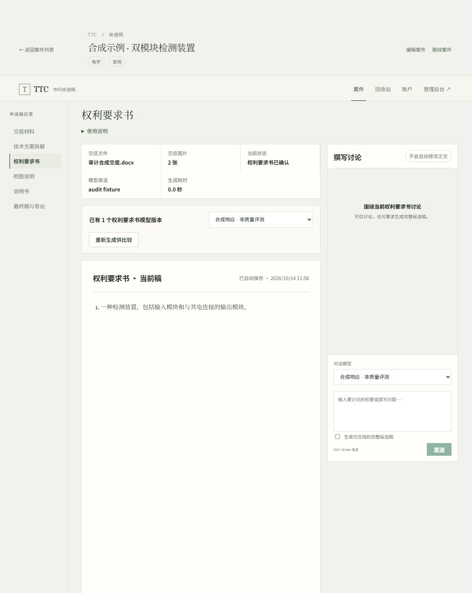
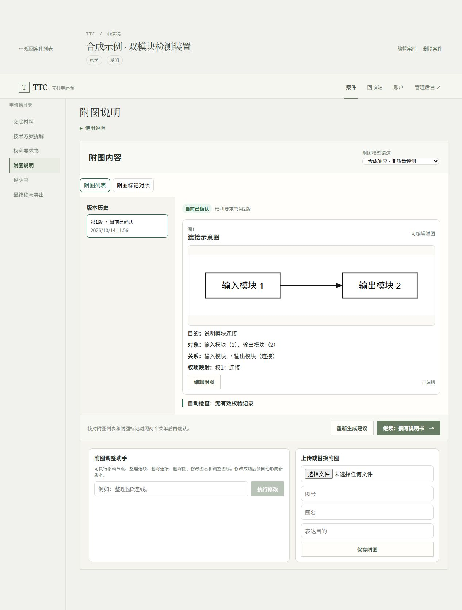
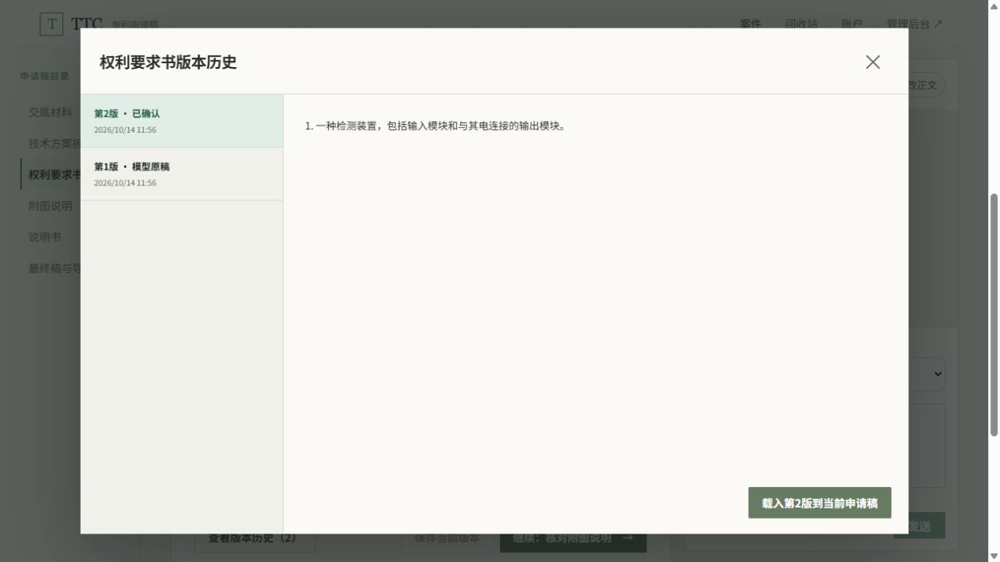

# what's TTC

下面都是TTC实际运行的界面。为了公开展示，单独建了合成测试环境，里面的交底、确认版本和产物来自预置测试数据，模型渠道也使用模拟响应。

这样可以看到界面和版本之间的关系，又不用接触真实案件。这组截图没有记录一次真实模型从头到尾生成的过程，也不用于证明成稿质量。

## 打开案件，接着上次的工作

工作台能看到案件及当前状态，打开后可以继续查看和修改。

## 先决定采用什么方案

我把技术问题、技术方案和技术效果放在一起，方便逐项查看。可以直接修改，也可以采纳或拒绝，确认后才用于后续起草。

截图里是一个很简单的合成方案：输入模块与输出模块连接。

## 查看权利要求，再决定是否确认

当前稿、模型选择和撰写讨论分开显示。可以先讨论问题，普通讨论不会自动改正文。

## 核对附图和标记

这个电学示例有真实的可编辑图源，可以看到对象、连接关系和权项映射。预置产物没有生成校验报告，界面里也保留了这条提示。

机械方向目前提供的是附图列表和标记建议，还没有完成机械图生成。

## 回头看之前的版本

历史里能区分模型原稿和已确认稿。要把旧稿载入当前文稿，需要明确操作。

## 如果现场演示，我会这样走

可以把这份[合成交底书](../examples/synthetic-case/DISCLOSURE.md)整理成 DOCX，依次走上传、方案采纳、权要确认、附图核对和说明书撰写。

最后组装最终稿，补齐缺失章节，确认后导出。这个前后端路径已经实现，后端有回归覆盖；这次采集截图没有重跑完整导出操作。

我也想展示一次失败处理：新任务失败时，之前能用的稿子还在。这类演示会明确标注模拟响应，避免把测试结果当成真实模型效果。

想直接体验一个不需要邀请的项目，可以打开我的[专利代理师考试学习系统](https://orphanwarrior.github.io/test-web/study.html)。
