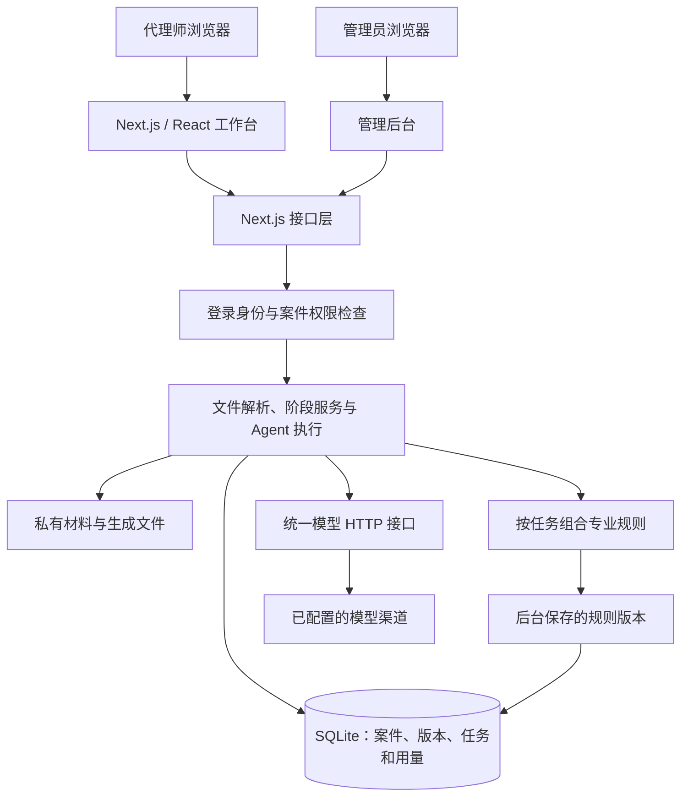
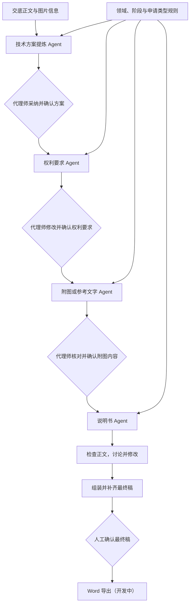
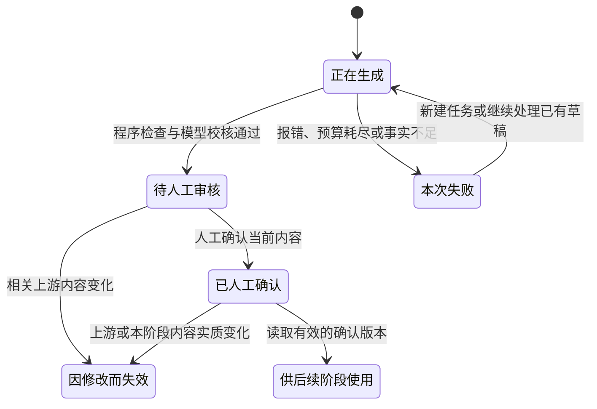

# TTC 是怎样跑起来的

TTC 用 Next.js 做成全栈应用，页面、接口和阶段服务放在同一个项目里。SQLite 存案件、版本和任务记录，交底文件、图片以及生成文件另外保存在私有目录。

内测阶段先用这套结构，把一件案件从上传到各阶段修改的过程接起来。下面的图画的是当前执行路径，专业规则正文和部署细节没有放进来。

## 整体结构

浏览器、手机和平板可以访问工作台，页面做了适配，全部页面在不同尺寸下的操作还没有逐一验完。

## 上传交底书

DOCX 的正文和图片通过 Mammoth 提取，JSZip 和 XML 解析用来检查文档结构。导入时限制文件大小、图片数量和解压后的大小，并记录内容指纹。

Word 公式目前会转成线性文字，还做不到完整理解数学语义。图片读取有权限检查，视觉分析的信息可以供后续使用。图片确认默认是自动模式，也可以配置成人工模式。

## 阶段之间怎么接

每个阶段能做的操作、读取的内容和输出要求分别设置。执行时保存草稿和校核记录，关键事实缺了、预算用完或用户取消，就停下来。

附图和实施例任务默认最多六次调用、九万个已报告的 Token、240 秒。供应商返回的用量可能不完整，单次请求也可能超过预估，这个限制还不能当成精确的费用上限。

项目里仍有旧编排工具。这里按当前接口默认走的路径介绍。

## 一份稿子怎样变成后续输入

图里把共通的关系放在一起，数据库中各阶段有各自的字段和任务记录。模型生成完说明书以后，仍然需要人查看和确认。

确认内容另存一份不再修改的版本，带时间和内容指纹。编辑中的稿子则有修订号，保存时核对客户端版本，避免两个窗口互相覆盖。

附图会分别记录技术内容和排版的变化。经过验证的纯排版调整，可以保留原来的说明书；实质内容变了，后面就要重新核对。

## 模型返回以后，还要检查一次

生成过程不一直占着数据库事务。准备切换当前稿时，再核对上游确认版本、交底内容、原来的当前稿和实际输出文件。输入过期或发生冲突，就留下本次结果和失败记录，原稿继续保留。

目前用进程内锁和持久化的账号占用检查处理同时执行的任务。分布式调度还没做，也还不能保证模型请求只执行一次。

## 模型和专业规则

模型通过原生 fetch 接入 Chat Completions 和 Responses，处理流式输出、完成信号、取消和超时。整次请求不会自动重跑。

专业规则按领域、阶段和申请类型组合，后台修改的版本可以覆盖内置规则。任务里记录用了哪套规则和哪些输入，方便回头查。允许模型调用哪些操作、何时发布结果，由代码控制。

## 账号和导出

普通账号读取自己的案件，管理员有内测管理和诊断权限。现在按个人账号隔离，还没有组织成员和协作机制。

最终稿的组装、补齐、确认和 Word 导出都有实现路径，导出读取确认版本。相关后端测试已通过，完整浏览器流程仍在补验，因此对外继续标为开发中。后台还有整件案卷的 ZIP 导出。

具体进度和检查范围见[功能表](FEATURE_STATUS.md)及[验证记录](VALIDATION.md)。
