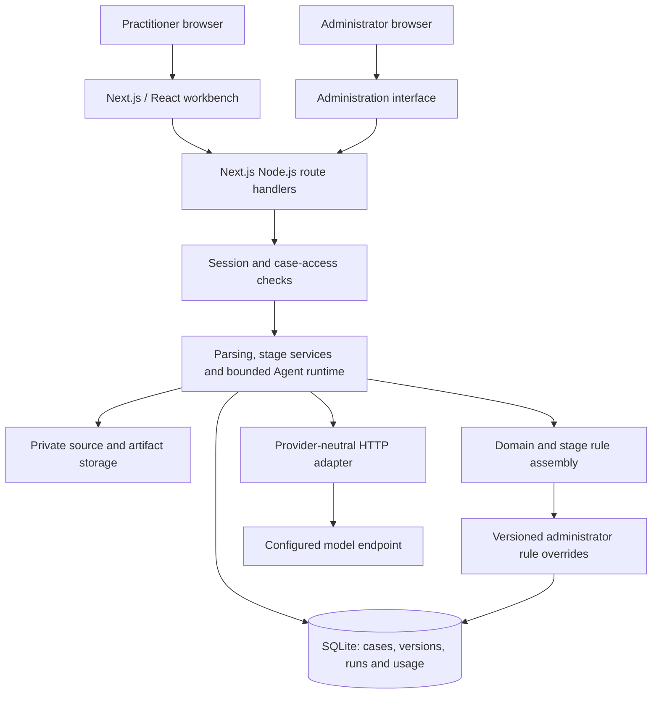
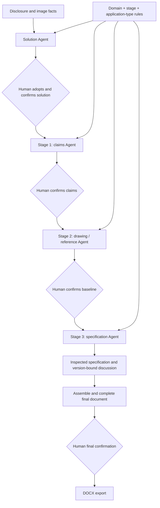
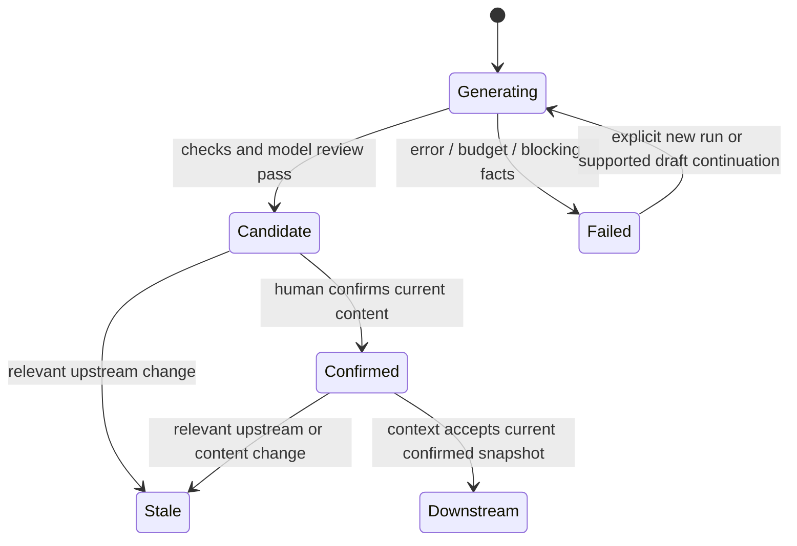

# Technical architecture

The diagrams describe inspected application paths. They omit credentials, deployment internals and proprietary rule text.

## High-level system

This is a full-stack Next.js application, not separate frontend and backend microservices. SQLite stores structured state; the filesystem stores source documents, images and generated artifacts. No Redis, distributed queue or vector database is used.

## Source ingestion

Mammoth extracts DOCX text and embedded images; JSZip and XML parsing inspect the document structure. Import limits constrain file size, image count and archive expansion. Content hashes bind source state. Word formula objects have a linear-text representation; this is not a complete mathematical document-understanding pipeline.

Private images are accessed through authorized application paths, not a public asset directory. Vision analysis can supply image facts to later stages. Image confirmation defaults to automatic mode; manual review is configurable. It is inaccurate to describe every image as manually approved by default.

## Current generation path

Solution, claim and artifact services share an application-owned execution runtime. Each stage gets its own allowed operations, context and output contract. The runtime records drafts, checks and review results and stops on budget exhaustion, cancellation or unresolved blocking facts.

Current artifact defaults cap a run at six model calls, 90,000 reported tokens and a 240-second execution budget. These are application controls; a provider call may exceed an estimate, and unknown usage remains unknown. They are not a vendor billing guarantee.

Older orchestration utilities remain in the repository. Their presence does not make them the default workflow.

## Confirmation and approval state

This is a conceptual flow across stages, not one shared database status enum. Stage 1 stores document/version confirmation state; drawing baselines and Stage 3 runs have their own statuses. Stage 3 completion does not itself mean final human acceptance.

Confirmed content is represented by immutable version records and fingerprints. Editable working drafts have revisions. Save and confirm routes reject stale client revisions instead of silently overwriting newer content.

Drawing semantic identity is separate from layout/render identity. A verified layout-only change need not invalidate Stage 3; a semantic change does.

## Publication and failure handling

Model work happens before a short publication transaction. Publication rechecks current confirmed upstream state, source hashes, the expected publication base and output files. A conflicting or stale result cannot replace the current artifact.

Failure retains diagnostic state and previously usable work. This does not provide exactly-once model execution or a general distributed job system. Per-process locks and persisted account admission checks address the current deployment model.

## Models, rules and context

The model registry selects a configured HTTP channel. A native fetch adapter supports Chat Completions and Responses, streaming response parsing, completion validation, cancellation and timeouts. Automatic full-call retries are disabled.

Domain rules, stage instructions and output contracts have separate responsibilities. The rule loader assembles the applicable pieces and uses versioned administrator overrides when present. Context and run records retain provenance and hashes. Rule bodies and prompts are not included in this showcase.

## Quality and access boundaries

Deterministic checks cover structures, identities, figures, references and snapshot bindings. Independent model review addresses professional issues; neither guarantees legal sufficiency.

Authenticated access checks enforce account ownership for case routes. Administrators have broader access for internal testing and diagnosis. This is individual account isolation, not a demonstrated organization-level multi-tenant platform.

Final acceptance and DOCX export have a workbench panel and backend paths. Only an accepted final snapshot can be exported. Backend behavior passed the selected SaaS suite; the browser interaction remains pending verification.
