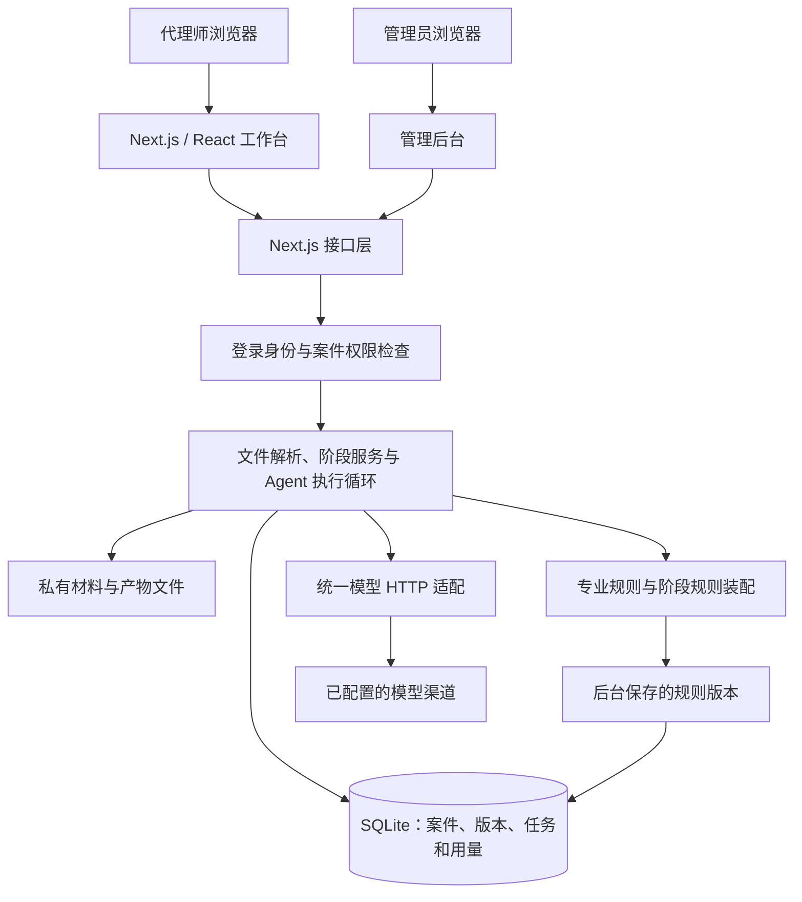
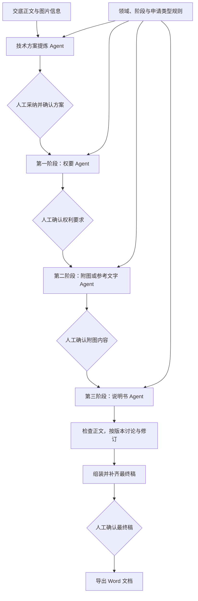
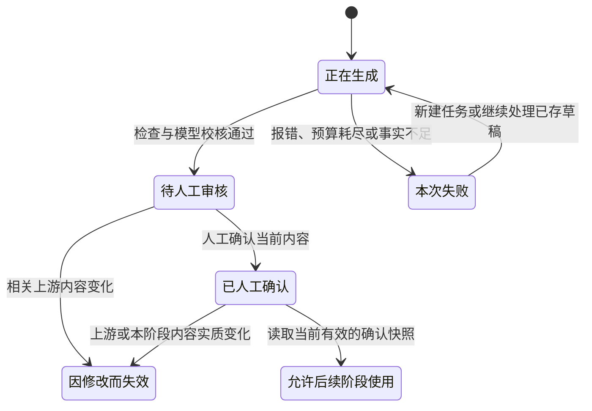

# TTC 是怎样跑起来的

我把 TTC 做成了一个 Next.js 全栈应用。页面、接口和阶段服务放在同一个项目里，SQLite 保存案件、版本和任务状态，交底文件、图片及生成产物保存在私有文件目录中。

下面几张图说明目前实际使用的路径，省略了凭据、部署细节和专业规则正文。

## 系统整体结构

当前没有引入微服务、Redis、向量数据库或分布式队列。我先围绕现有内测规模，把实际任务的状态和衔接做好。

## 交底书怎样进入系统

DOCX 正文和图片通过 Mammoth 提取，JSZip 与 XML 解析用于检查文档结构。导入时会限制文件大小、图片数量和压缩包展开大小，并记录内容指纹。

Word 公式会转成线性文字供后续理解，目前还没有完整的数学语义解析能力。

交底图片通过带权限检查的路径读取。视觉分析得到的信息可以进入后续上下文；图片确认默认采用自动模式，也可以配置成人工模式。

## 各阶段怎样衔接

技术方案、权要和其他产物共用项目自己的执行循环，但每个阶段有各自的操作范围、上下文和输出要求。执行中保存草稿、检查与校核记录；预算耗尽、用户取消或关键事实不足时停止。

附图和实施例任务的默认预算为六次调用、90,000 个已报告 tokens 和 240 秒。它限制的是程序执行，不能直接当成供应商的计费上限。

仓库里还保留了一些旧编排工具。判断当前流程时，我以实际接口的默认调用路径为准。

## 生成、确认和失效是什么关系

这张图说明几个阶段共通的关系，各阶段在数据库里并不共用一个状态字段。权要保存文档和确认版本，附图与说明书有各自的任务状态。说明书生成完成，也不等于代理师已经验收了最终稿。

我把确认内容保存成不再修改的版本，记录时间和内容指纹；可编辑工作稿则有修订号。保存和确认时会检查客户端版本，避免另一个窗口把新稿覆盖掉。

附图另行记录语义与排版身份：实质内容变化会影响后续，经过验证的纯排版调整可以不让说明书失效。

## 怎样发布结果、处理失败

模型调用在数据库发布事务之外执行。准备切换当前版本时，会重新核对上游快照、交底指纹、原来的当前版本和实际输出文件。

发生冲突或输入已过期时，结果不能成为当前稿。失败记录和原有可用内容会留下来，方便继续处理和定位。

目前使用进程内锁和持久化的账户执行占用检查，没有实现通用分布式调度，也没有承诺模型请求只执行一次。

## 模型、规则和上下文

模型渠道由注册表管理，原生 fetch 适配 Chat Completions 与 Responses，处理流式输出、完成信号、取消和超时。整次请求不会自动重试。

专业指导按领域、阶段和申请类型装配，后台保存的版本可以覆盖自带规则。执行权限和发布条件由代码控制，任务保留上下文来源与指纹。专业提示词和完整规则正文不在这个公开仓库里。

## 校验、权限和导出

程序校验检查格式、图号、标记、产物及上下游绑定；独立模型校核处理专业问题。最终内容仍然需要代理师判断。

普通账号只能访问自己的案件，管理员有用于内测管理和诊断的额外权限。当前是个人账号隔离，还没有组织级成员与协作模型。

最终稿在工作台有组装、补齐、确认和导出入口，导出必须读取已确认快照。相关后端测试已通过，这次截图没有重新跑完整的浏览器导出流程。
